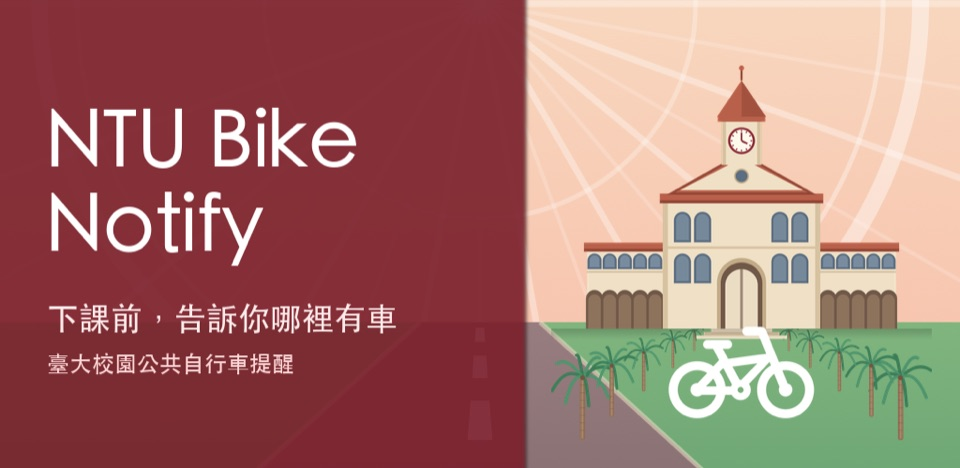
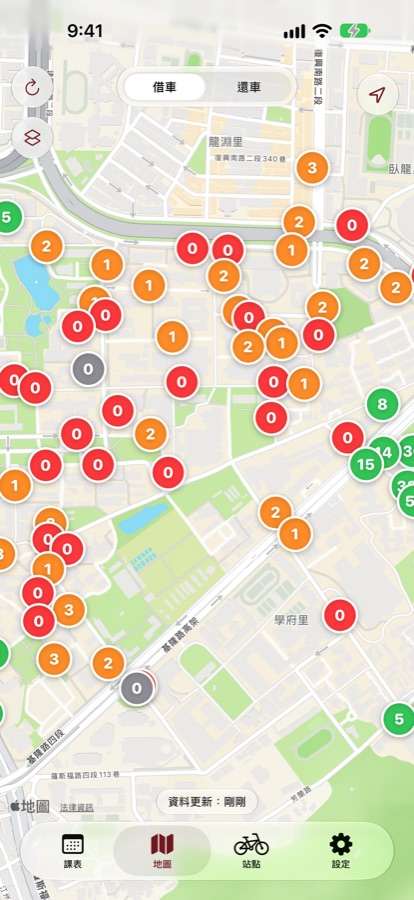
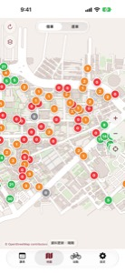
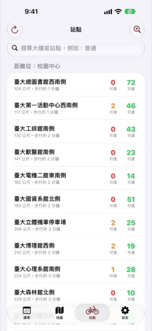
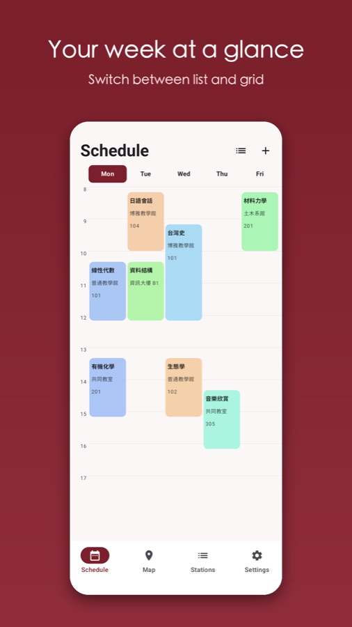
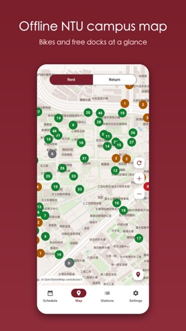
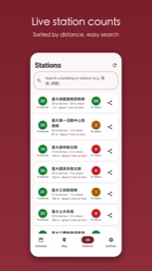
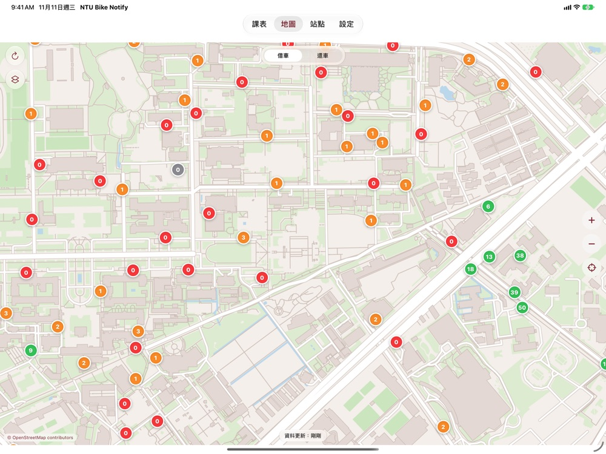
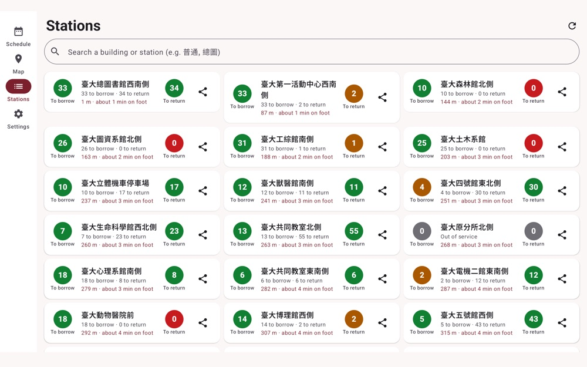

<p align="center"></p>

<p align="center"><a href="README.md">繁體中文</a> · <b>English</b> · <a href="README.ja.md">日本語</a> · <a href="README.ko.md">한국어</a></p>

<h3 align="center">🌐 <a href="https://ntubikenotify.nannancat.tw/">Official website｜ntubikenotify.nannancat.tw</a></h3>

<p align="center"><a href="https://ntubikenotify.nannancat.tw/">Official website</a> · <a href="https://apps.apple.com/us/app/ntu-bike-notify/id6831039286">App Store</a> · <a href="../../releases/latest">Download APK</a> · <a href="https://ntubikenotify.nannancat.tw/map/">Web map</a></p>

# NTU Bike Notify

A class-schedule-aware reminder for bike-sharing stations on the NTU campus (Taipei).

A reminder app for bike-sharing stations on the National Taiwan University (NTU) campus. Enter your class schedule and, a few minutes before class ends (5 by default), the app tells you how many bikes are available at the nearest station. If there are none, it points you to the next nearest station with bikes, with walking distance. If your next class is in a different building, it also tells you where to return the bike.

## Download

| Platform | Link |
|---|---|
| **iOS / iPadOS** (iPhone and iPad, 18.6+) | [App Store](https://apps.apple.com/us/app/ntu-bike-notify/id6831039286) |
| **Android** (phones and tablets, Android 14+) | [Download APK](../../releases/latest) (see install steps below) |
| **Web** (no install) | [Live map](https://ntubikenotify.nannancat.tw/map/) · [Website](https://ntubikenotify.nannancat.tw/) |

> The Android version is in closed testing on Google Play. Until it is published, you can install the APK directly.

## Features

- Schedule: enter manually, import CSV / ICS, or import a weekly-schedule screenshot (recognition runs on your phone)
- Pre-dismissal reminder: bikes available at the nearest station; if none, the next nearest station with bikes (up to 3 stations away)
- Return reminder: finds the nearest station with free docks near your next class building
- Campus station map and list (NTU campus only)
- iOS / iPadOS Live Activity / Dynamic Island; Android ongoing notification (Live Updates on Android 16+)
- Traditional Chinese, English, Japanese, Korean
- Station coverage: NTU-named stations plus any station within 200 m (including Gongguan MRT exits); manual refresh, and auto-refresh when you return to the app
- Maps: iOS / iPadOS offers Apple Maps or a built-in open-source map (OpenStreetMap, no browsing area sent out); Android uses the built-in OpenStreetMap map
- Web live map: no install needed, check bikes and free docks at NTU campus stations (plus those within 200 m) from a computer
- iOS / iPadOS 1.2: Siri / Shortcuts (ask "where are bikes now" or "next class"; Siri in Traditional Chinese needs iOS 27.3 or later), home-screen and Lock Screen widgets, Apple Watch, iMessage station cards, iPad and landscape layouts
- Android 1.2: tablet layouts, a home-screen widget, launcher shortcuts and station sharing
- Android 1.3: dark mode (Settings → Appearance), station badges no longer clipped at large text sizes, About links to the website / developer / GitHub / X, privacy and support moved to the website's Android pages
- iOS / iPadOS 1.3: iPad layout fixes, Dynamic Type and accessibility improvements, Reduce Motion support, Siri requests are no longer logged, About icon links

## Screenshots

**iPhone**

<p>




</p>

**Android**

<p>




</p>

<details>
<summary>iPad and Android tablet (landscape)</summary>

<p>


</p>

</details>

(Fictional schedule. Phones are portrait only; iPad and Android tablets also support landscape. iOS / iPadOS screenshots show the Traditional Chinese UI.)

## iOS / iPadOS details

- **Download**: [App Store](https://apps.apple.com/us/app/ntu-bike-notify/id6831039286) (free)
- **Requirements**: iOS / iPadOS 18.6 or later (iPhone and iPad)
- **Languages**: Traditional Chinese, English, Japanese, Korean (switch in the app under Settings → Language, or in system settings)
- **Dynamic Island / Lock Screen**: a Live Activity shows the countdown and available bikes during the reminder window; it falls back to a regular notification if disabled or unsupported
- **Data sync**: your schedule, reminder time and building corrections are stored on the device and synced to **your own private iCloud database**, so they restore on a new phone; the developer cannot read them
- **Permissions**: Notifications (required, for reminders); Location (optional, distances are computed on your phone and never uploaded); Photos (optional, only the screenshot you pick manually when importing a schedule, recognized on-device)
- **Import**: CSV, ICS, weekly-schedule screenshot, or manual entry
- **Other 1.2 features**: Siri / Shortcuts and App Intents, home-screen and Lock Screen widgets, Apple Watch app (schedule is sent from the iPhone), iMessage extension (pick a station and send a bike-count card to a friend), iPad layouts
- **Privacy**: [Privacy policy](https://ntubikenotify.nannancat.tw/privacy/) · [Support](https://ntubikenotify.nannancat.tw/support/). App Store privacy labels declare "Device ID" and "Schedule copy", used only for app functionality, no tracking

## Android installation

1. Download `NTU-Bike-Notify-1.3.apk` from [Releases](../../releases/latest).
2. Open the file on your phone; if prompted, allow installing apps from this source (browser / Files).
3. Open the app and allow notifications.

**Verify the download** (optional): the APK SHA-256 is in the release notes; the signing certificate SHA-256 is `7d5ef38b3c7fef6b13525b83d2206db567f7ad5ee00c18ab14d21e40b45a8d64`.

```
shasum -a 256 NTU-Bike-Notify-1.3.apk
apksigner verify --print-certs NTU-Bike-Notify-1.3.apk
```

> This APK uses a different signing key from the future Google Play version; uninstall it before installing the Play version.

## Privacy

- Your schedule and settings stay on your phone (iOS / iPadOS: iCloud; Android: local storage plus Google backup).
- The server keeps only the minimum copy needed to send reminders (a random device ID and your schedule). **Location is never uploaded**; distances are computed on your phone. No accounts, ads or tracking.
- Privacy policy: [iOS / iPadOS](https://ntubikenotify.nannancat.tw/privacy/) · [Android](https://ntubikenotify.nannancat.tw/privacy/android/)
- Support: [iOS / iPadOS](https://ntubikenotify.nannancat.tw/support/) · [Android](https://ntubikenotify.nannancat.tw/support/android/)

## Data sources and notices

- Station data comes from the government open-data feed for public bike sharing.
- Android map data © [OpenStreetMap contributors](https://www.openstreetmap.org/copyright) (ODbL).
- This is an independent personal project, not affiliated with or endorsed by National Taiwan University or YouBike.

This repository contains release files and documentation only, not source code. © 2026 All rights reserved.
