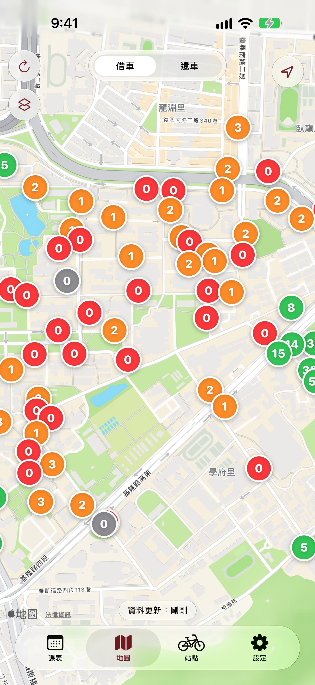
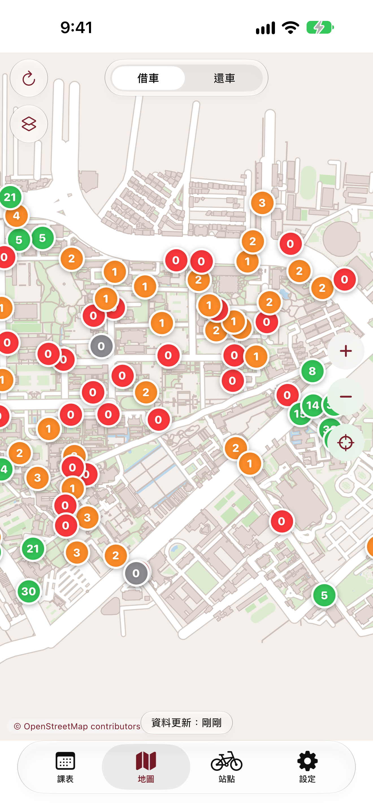
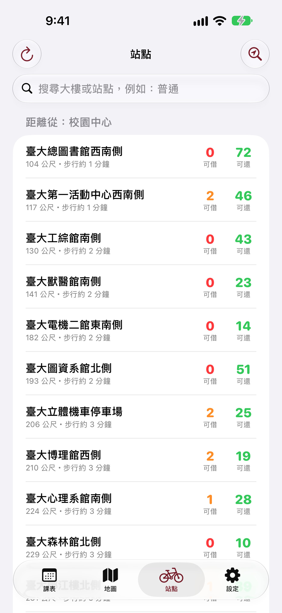
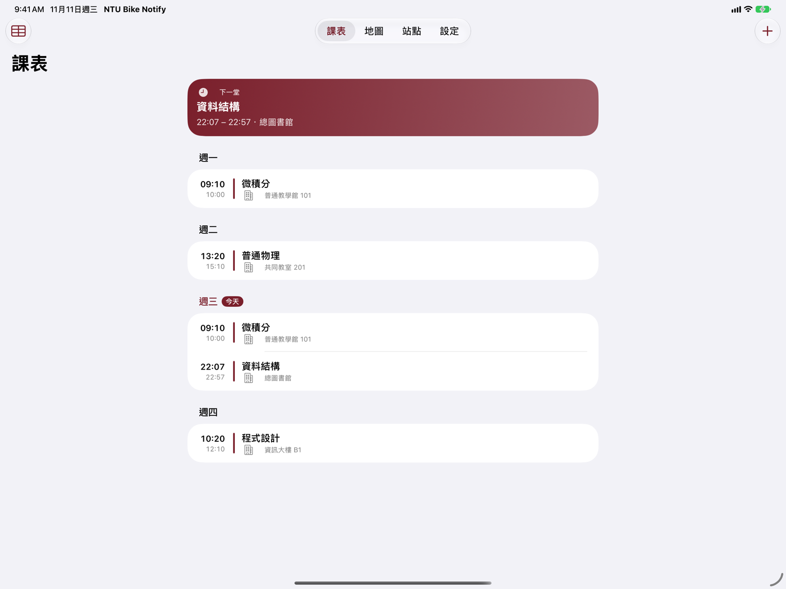
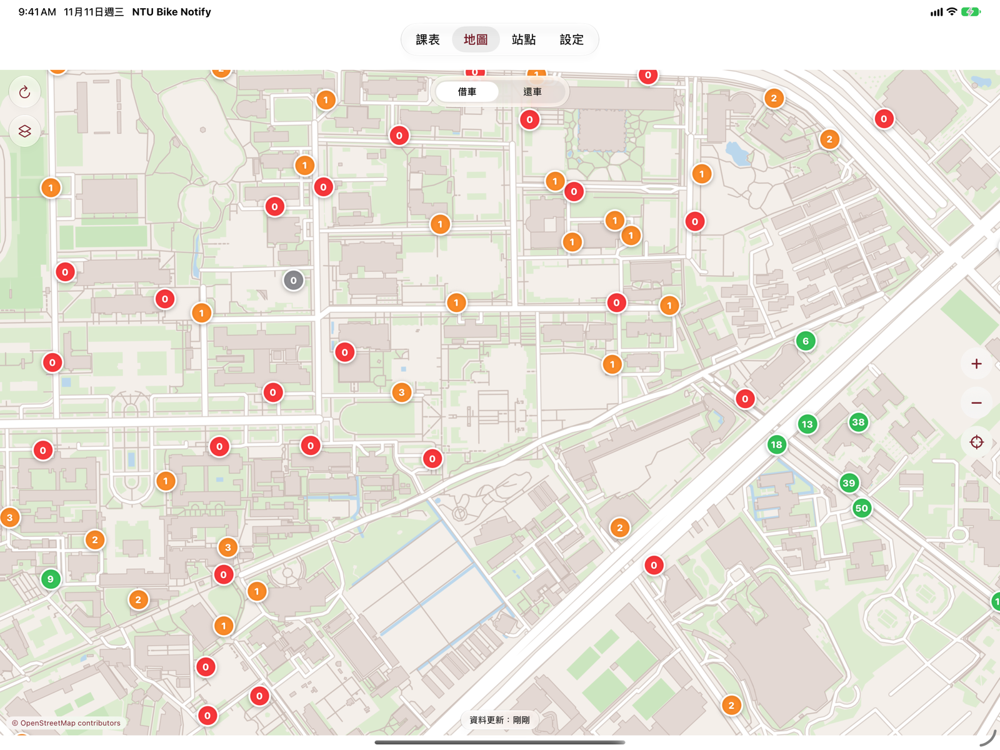
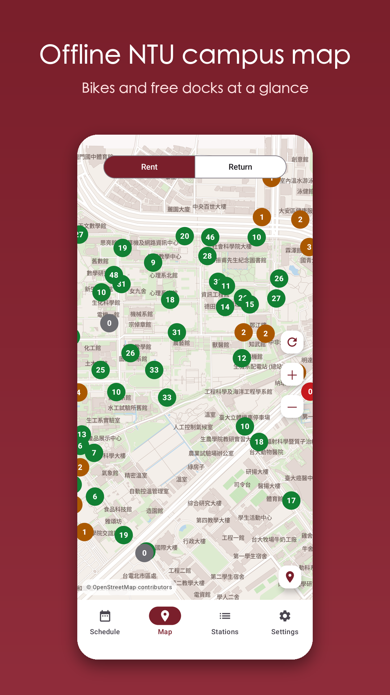
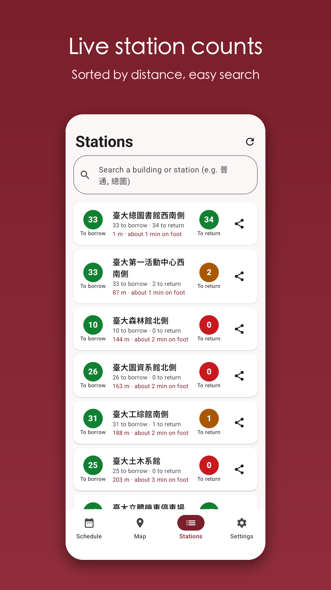
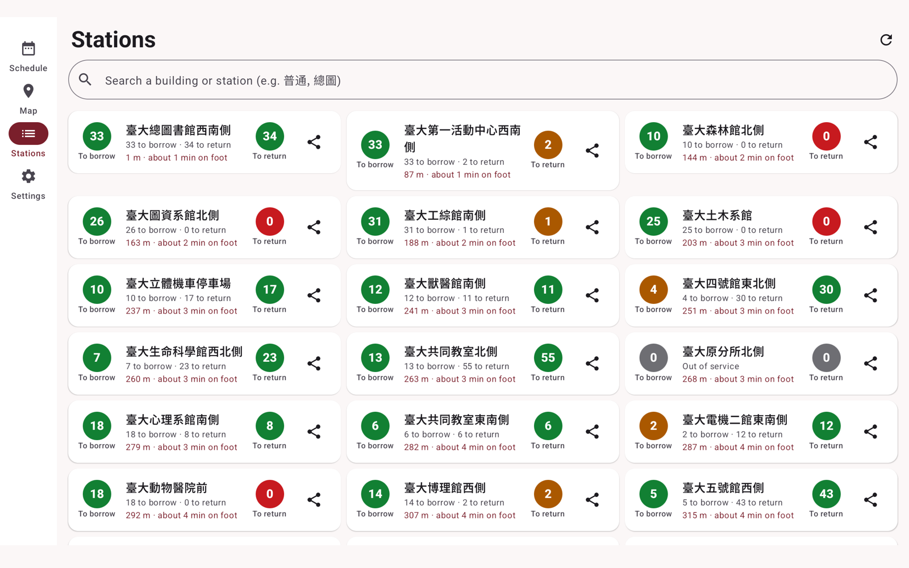
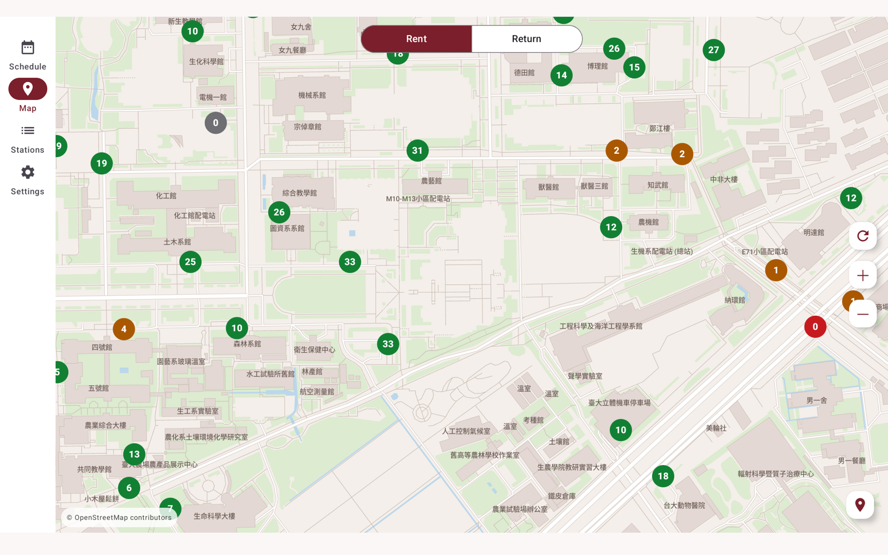

<p align="center"></p>

<p align="center"><a href="README.md">繁體中文</a> · <a href="README.en.md">English</a> · <b>日本語</b> · <a href="README.ko.md">한국어</a></p>

# NTU Bike Notify

時間割に合わせて台大キャンパスのシェアサイクルを通知するアプリ（台北）。

国立台湾大学（NTU）キャンパス内のシェアサイクル（YouBike）のステーション情報をお知らせするアプリです。時間割を登録すると、授業終了の数分前（初期値は5分前）に、最寄りのステーションで借りられる自転車の台数を通知します。0台のときは、次に近い空きのあるステーションを徒歩距離つきで案内します。次の授業が別の建物の場合は、返却に向いたステーションも知らせます。

## ダウンロード

| プラットフォーム | リンク |
|---|---|
| **iOS**（iOS 18.6 以上） | [App Store](https://apps.apple.com/us/app/ntu-bike-notify/id6831039286) |
| **Android**（Android 14 以上） | [APK をダウンロード](../../releases/latest)（下のインストール手順を参照） |

> Android 版は Google Play でクローズドテスト中です。公開までの間、APK を直接インストールできます。

## 機能

- 時間割：手入力、CSV / ICS の取り込み、週間時間割のスクリーンショット取り込み（認識は端末内で実行）
- 授業終了前の通知：最寄りステーションの貸出可能台数。0台なら次に近い空きステーション（最大3駅先まで）
- 返却通知：次の授業の建物に近い、空きスロットのあるステーションを案内
- 台大キャンパスのステーション地図と一覧（キャンパス内のみ）
- iOS の Live Activity / ダイナミックアイランド、Android の継続通知（Android 16 以上は Live Updates）
- 繁体字中国語・英語・日本語・韓国語に対応
- 対象ステーション：台大の名前が付くステーションと、その周囲 200 m 以内のステーション（公館駅の出口を含む）。手動更新に対応し、アプリに戻ると自動更新
- 地図：iOS は Apple マップまたは内蔵のオープンソース地図（OpenStreetMap、閲覧範囲を外部に送信しません）を選べます。Android は内蔵の OpenStreetMap 地図を使用
- 1.2 の新機能：Siri／ショートカット（「今どこに自転車がある？」「次の授業は？」。繁体字中国語の Siri は iOS 27.3 以上が必要）、ホーム画面・ロック画面のウィジェット、Apple Watch、iMessage でステーションの台数カードを送信、iPad と横向き表示。Android はタブレット表示、ホーム画面ウィジェット、ランチャーのショートカット、ステーション共有

## スクリーンショット

**iPhone**

<p>




</p>

**iPad（横向き）**

<p>


</p>

**Android スマートフォン**

<p>




</p>

**Android タブレット（横向き）**

<p>


</p>

（スクリーンショットは架空の時間割を使用しています。スマートフォンは縦向きのみ、iPad と Android タブレットは横向きにも対応します。iOS は繁体字中国語の UI、Android は英語の UI です。）

## iOS 版の詳細

- **ダウンロード**：[App Store](https://apps.apple.com/us/app/ntu-bike-notify/id6831039286)（無料）
- **動作環境**：iOS 18.6 以上（iPhone）
- **言語**：繁体字中国語、英語、日本語、韓国語（アプリ内の「設定 → 言語」またはシステム設定で切り替え）
- **ダイナミックアイランド／ロック画面**：通知の時間帯に Live Activity でカウントダウンと貸出可能台数を表示。無効または非対応の場合は通常の通知に切り替わります
- **データ同期**：時間割・通知時間・建物位置の補正は端末に保存され、**あなた自身の iCloud プライベートデータベース**に同期されます。機種変更時に復元でき、開発者は内容を読めません
- **必要な権限**：通知（必須・リマインダー用）／位置情報（任意・距離は端末内で計算し、送信しません）／写真（任意・時間割の取り込み時に自分で選んだ画像のみ、端末内で認識）
- **取り込み**：CSV、ICS、週間時間割のスクリーンショット、手入力
- **1.2 のその他の機能**：Siri／ショートカットと App Intents、ホーム画面・ロック画面のウィジェット、Apple Watch アプリ（時間割は iPhone から送信）、iMessage 拡張（ステーションを選んで台数カードを友だちに送信）、iPad 対応
- **プライバシー**：[プライバシーポリシー](https://ntu-bike-notify.nannancat.tw/privacy) ・ [サポート](https://ntu-bike-notify.nannancat.tw/support)。App Store のプライバシー表示では「デバイス ID」と「時間割のコピー」を申告しており、用途はアプリの機能のみで、トラッキングは行いません

## Android のインストール

1. [Releases](../../releases/latest) から `NTU-Bike-Notify-1.2.apk` をダウンロードします。
2. スマートフォンでファイルを開き、確認が出たら（ブラウザ／ファイル）からのインストールを許可します。
3. アプリを開き、通知を許可します。

**ダウンロードの確認**（任意）：APK の SHA-256 は Release の説明に記載しています。署名証明書の SHA-256 は次のとおりです `7d5ef38b3c7fef6b13525b83d2206db567f7ad5ee00c18ab14d21e40b45a8d64`.

```
shasum -a 256 NTU-Bike-Notify-1.2.apk
apksigner verify --print-certs NTU-Bike-Notify-1.2.apk
```

> この APK は、今後公開される Google Play 版とは署名鍵が異なります。Play 版を入れる前にこの版をアンインストールしてください。

## プライバシー

- 時間割と設定はあなたの端末内に保存されます（iOS：iCloud、Android：端末内＋Google バックアップ）。
- サーバーが保持するのは、通知の送信に必要な最小限のコピー（ランダムな端末 ID と時間割）のみです。**位置情報は送信しません**。距離は端末内で計算します。アカウント登録・広告・トラッキングはありません。
- プライバシーポリシー：[iOS](https://ntu-bike-notify.nannancat.tw/privacy) ・ [Android](https://ntu-bike-notify.nannancat.tw/privacy/android)
- サポート：[iOS](https://ntu-bike-notify.nannancat.tw/support) ・ [Android](https://ntu-bike-notify.nannancat.tw/support/android)

## データ出典と注意事項

- ステーション情報は、政府のオープンデータ（公共自転車のリアルタイム情報）を利用しています。
- Android の地図データ © [OpenStreetMap contributors](https://www.openstreetmap.org/copyright)（ODbL）。
- 本アプリは個人による独立したプロジェクトであり、国立台湾大学および YouBike（微笑單車）とは提携・承認関係にありません。

このリポジトリには配布ファイルと説明のみが含まれ、ソースコードは含まれません。© 2026 All rights reserved.
