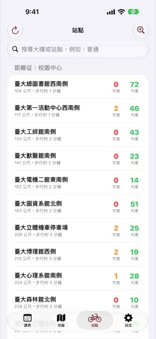
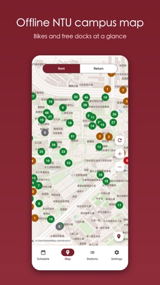
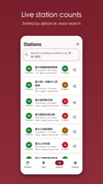
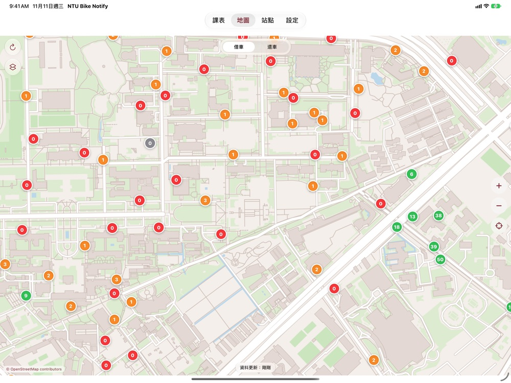
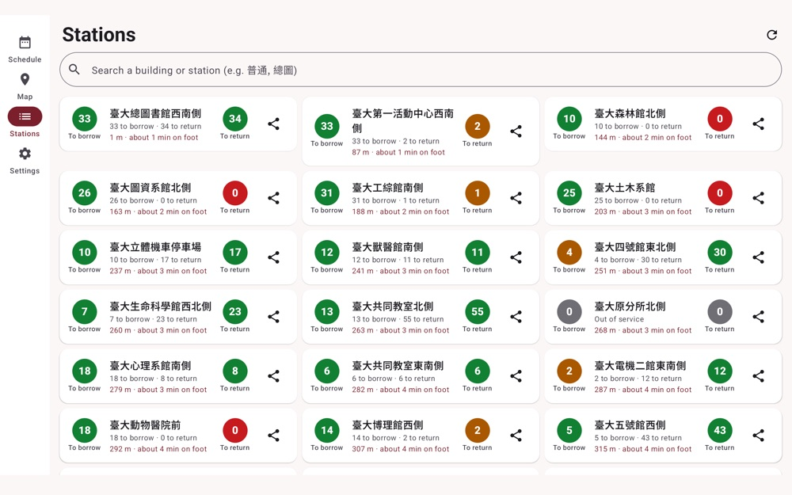

<p align="center"></p>

<p align="center"><a href="README.md">繁體中文</a> · <a href="README.en.md">English</a> · <a href="README.ja.md">日本語</a> · <b>한국어</b></p>

# NTU Bike Notify

수업 시간표에 맞춰 알려 주는 국립타이완대학(NTU) 캠퍼스 공공자전거 알림 앱 (타이베이).

국립타이완대학(NTU) 캠퍼스의 공공자전거(YouBike) 대여소 정보를 알려 주는 앱입니다. 시간표를 입력하면 수업이 끝나기 몇 분 전(기본 5분)에 가장 가까운 대여소에서 빌릴 수 있는 자전거 수를 알려 줍니다. 자전거가 0대이면 그다음으로 가까운 대여소를 도보 거리와 함께 안내합니다. 다음 수업이 다른 건물이면 반납하기 좋은 대여소도 알려 줍니다.

## 다운로드

| 플랫폼 | 링크 |
|---|---|
| **iOS** (iOS 18.6 이상) | [App Store](https://apps.apple.com/us/app/ntu-bike-notify/id6831039286) |
| **Android** (Android 14 이상) | [APK 다운로드](../../releases/latest) (아래 설치 방법 참고) |
| **웹 버전** (설치 불필요) | [실시간 지도](https://ntubikenotify.nannancat.tw/map/) · [공식 사이트](https://ntubikenotify.nannancat.tw/) |

> Android 버전은 Google Play 비공개 테스트 중입니다. 정식 출시 전까지 APK를 직접 설치할 수 있습니다.

## 기능

- 시간표: 직접 입력, CSV / ICS 가져오기, 주간 시간표 스크린샷 가져오기 (인식은 기기 안에서 처리)
- 수업 종료 전 알림: 가장 가까운 대여소의 대여 가능 대수. 0대이면 다음으로 가까운 대여소(최대 3개 대여소 떨어진 곳까지)
- 반납 알림: 다음 수업 건물 근처에서 빈 거치대가 있는 대여소 안내
- 대만대 캠퍼스 대여소 지도와 목록 (캠퍼스 안만 해당)
- iOS Live Activity / 다이내믹 아일랜드, Android 지속 알림 (Android 16 이상은 Live Updates)
- 번체 중국어, 영어, 일본어, 한국어 지원
- 대여소 범위: 이름에 대만대가 들어간 대여소와 반경 200 m 이내 대여소(공관역 출구 포함). 수동 새로고침 지원, 앱으로 돌아오면 자동 새로고침
- 지도: iOS는 Apple 지도 또는 내장 오픈소스 지도(OpenStreetMap, 열람 범위를 외부로 보내지 않음) 선택 가능. Android는 내장 OpenStreetMap 지도 사용
- 웹 버전 실시간 지도: 설치 없이 컴퓨터에서 대만대 캠퍼스(주변 200 m 포함) 정류소의 대여 가능 대수와 빈 거치대 확인
- 1.2 새 기능: Siri/단축어("지금 어디에 자전거가 있어?", "다음 수업은?"; 번체 중국어 Siri는 iOS 27.3 이상 필요), 홈 화면·잠금 화면 위젯, Apple Watch, iMessage로 대여소 현황 카드 보내기, iPad 및 가로 화면. Android는 태블릿 화면, 홈 화면 위젯, 런처 바로가기, 대여소 공유

## 스크린샷

**iPhone**

<p>



</p>

**Android**

<p>




</p>

<details>
<summary>iPad 및 Android 태블릿 (가로)</summary>

<p>


</p>

</details>

(가상의 시간표 사용. 휴대폰은 세로만, iPad와 Android 태블릿은 가로도 지원. iOS는 번체 중국어, Android는 영어 UI입니다.)

## iOS 상세 정보

- **다운로드**: [App Store](https://apps.apple.com/us/app/ntu-bike-notify/id6831039286) (무료)
- **요구 사항**: iOS 18.6 이상 (iPhone)
- **언어**: 번체 중국어, 영어, 일본어, 한국어 (앱 안의 설정 → 언어 또는 시스템 설정에서 변경)
- **다이내믹 아일랜드 / 잠금 화면**: 알림 시간대에 Live Activity로 카운트다운과 대여 가능 대수를 표시합니다. 꺼져 있거나 지원되지 않으면 일반 알림으로 대체됩니다
- **데이터 동기화**: 시간표, 알림 시간, 건물 위치 보정은 기기에 저장되고 **본인의 iCloud 개인 데이터베이스**에 동기화됩니다. 새 휴대폰에서 복원할 수 있으며 개발자는 내용을 볼 수 없습니다
- **필요한 권한**: 알림(필수, 리마인더용) / 위치(선택, 거리는 기기에서 계산하며 전송하지 않음) / 사진(선택, 시간표를 가져올 때 직접 고른 이미지만, 기기 안에서 인식)
- **가져오기**: CSV, ICS, 주간 시간표 스크린샷, 직접 입력
- **그 밖의 1.2 기능**: Siri/단축어와 App Intents, 홈 화면·잠금 화면 위젯, Apple Watch 앱(시간표는 iPhone에서 전송), iMessage 확장(대여소를 골라 자전거 수 카드를 친구에게 전송), iPad 레이아웃
- **개인정보**: [개인정보 처리방침](https://ntubikenotify.nannancat.tw/privacy/) · [지원](https://ntubikenotify.nannancat.tw/support/). App Store 개인정보 항목에는 "기기 ID"와 "시간표 사본"을 신고했으며, 앱 기능에만 사용하고 추적하지 않습니다

## Android 설치

1. [Releases](../../releases/latest)에서 `NTU-Bike-Notify-1.2.apk`를 다운로드합니다.
2. 휴대폰에서 파일을 열고, 안내가 나오면 해당 출처(브라우저 / 파일)의 앱 설치를 허용합니다.
3. 앱을 열고 알림을 허용합니다.

**다운로드 확인** (선택): APK의 SHA-256은 릴리스 설명에 있습니다. 서명 인증서 SHA-256은 다음과 같습니다 `7d5ef38b3c7fef6b13525b83d2206db567f7ad5ee00c18ab14d21e40b45a8d64`.

```
shasum -a 256 NTU-Bike-Notify-1.2.apk
apksigner verify --print-certs NTU-Bike-Notify-1.2.apk
```

> 이 APK는 이후 출시될 Google Play 버전과 서명 키가 다릅니다. Play 버전을 설치하기 전에 이 버전을 먼저 삭제하세요.

## 개인정보

- 시간표와 설정은 본인의 휴대폰에 저장됩니다 (iOS: iCloud, Android: 로컬 저장소 + Google 백업).
- 서버는 알림 발송에 필요한 최소한의 사본(무작위 기기 ID와 시간표)만 보관합니다. **위치는 전송하지 않으며** 거리는 휴대폰에서 계산합니다. 계정, 광고, 추적이 없습니다.
- 개인정보 처리방침: [iOS](https://ntubikenotify.nannancat.tw/privacy/) · [Android](https://ntu-bike-notify.nannancat.tw/privacy/android)
- 지원: [iOS](https://ntubikenotify.nannancat.tw/support/) · [Android](https://ntu-bike-notify.nannancat.tw/support/android)

## 데이터 출처 및 고지

- 대여소 정보는 정부 공공데이터(공공자전거 실시간 정보)를 사용합니다.
- Android 지도 데이터 © [OpenStreetMap contributors](https://www.openstreetmap.org/copyright) (ODbL).
- 본 앱은 개인이 만든 독립 프로젝트이며 국립타이완대학 및 YouBike와 제휴하거나 보증받은 관계가 아닙니다.

이 저장소에는 배포 파일과 설명만 있으며 소스 코드는 포함하지 않습니다. © 2026 All rights reserved.
