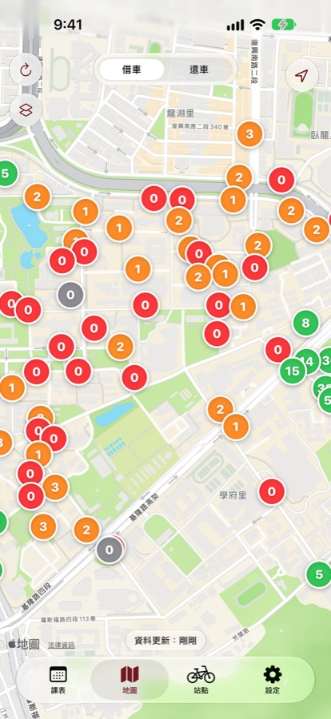
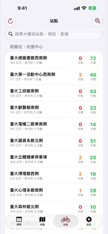
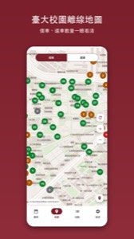
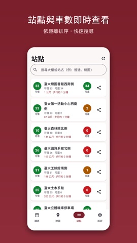
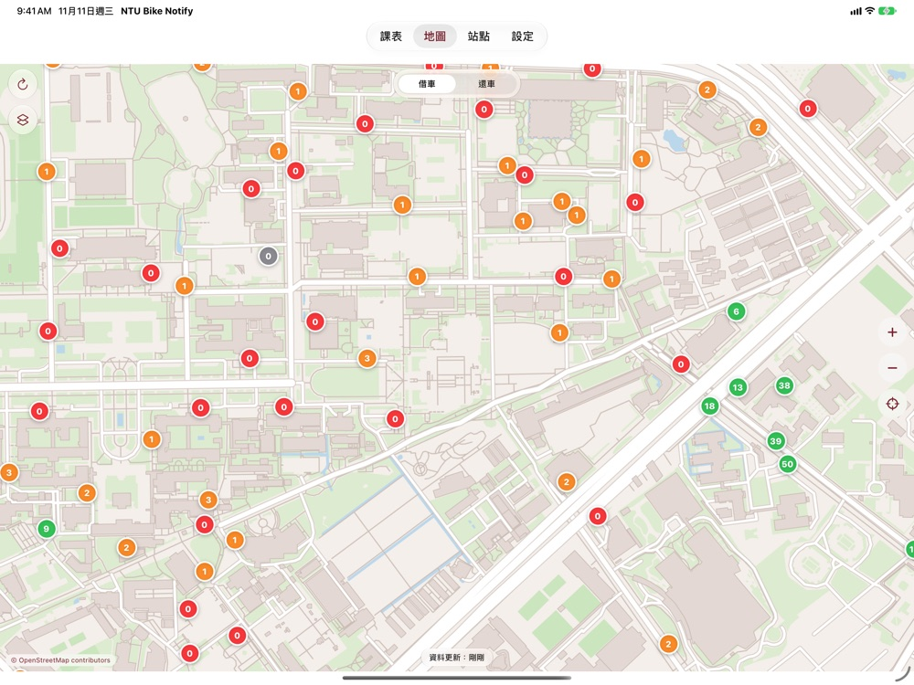
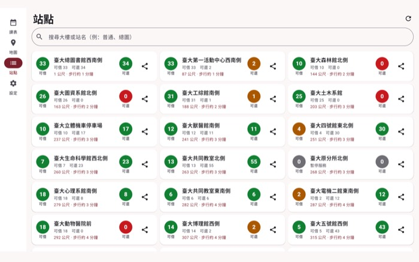

<p align="center"></p>

<p align="center"><b>繁體中文</b> · <a href="README.en.md">English</a> · <a href="README.ja.md">日本語</a> · <a href="README.ko.md">한국어</a></p>

# NTU Bike Notify

台大校園公共自行車（YouBike）下課提醒 App。輸入課表，下課前 N 分鐘（預設 5 分鐘）提醒你最近站點還有幾輛車；沒車就告訴你次近有車的站，並附步行距離。下一堂課在不同大樓時，也會提醒你去哪個站還車。

A class-schedule-aware reminder for bike-sharing stations on the NTU campus (Taipei). 繁中 / English / 日本語 / 한국어.

## 下載 Download

| 平台 | 連結 |
|---|---|
| **iOS**（iOS 18.6+） | [App Store](https://apps.apple.com/us/app/ntu-bike-notify/id6831039286) |
| **Android**（Android 14+） | [下載 APK](../../releases/latest)（見下方安裝說明） |
| **網頁版**（免安裝） | [即時地圖](https://ntubikenotify.nannancat.tw/map/) · [官網](https://ntubikenotify.nannancat.tw/) |

> Android 版正在 Google Play 封閉測試中，上架前先提供 APK 直接安裝。

## 功能

- 課表：手動輸入、匯入 CSV / ICS、匯入週課表截圖（辨識在手機上完成）
- 下課前提醒：最近站點可借車數；0 車時報次近有車站（最多往外 3 站）
- 還車提醒：依下一堂課的大樓找最近有空柱的站
- 台大校園站點地圖與列表（僅限校園範圍）
- iOS Live Activity / 動態島；Android 持續通知（Android 16+ Live Updates）
- 繁中、English、日本語、한국어
- 站點範圍：臺大站＋周邊 200 公尺內的站（含公館站出口）；可手動更新，回到 App 時自動更新
- 地圖：iOS 可選 Apple 地圖或內建開源地圖（OpenStreetMap，不送出瀏覽範圍）；Android 使用內建 OpenStreetMap 地圖
- 網頁版即時地圖：電腦上不用安裝，直接查看臺大校園（含周邊 200 公尺）各站的可借車數與空位
- 1.2 新增：Siri／捷徑（問「現在哪裡有車」「下一堂課」；繁體中文 Siri 需 iOS 27.3 以上）、桌面與鎖定畫面小工具、Apple Watch、iMessage 傳送站點車數、iPad 與橫向畫面；Android 平板版面、桌面小工具、桌面長按捷徑、站點分享

## 截圖

**iPhone**

<p>




</p>

**Android**

<p>




</p>

<details>
<summary>iPad 與 Android 平板（橫向）</summary>

<p>


</p>

</details>

（截圖使用虛構課表。手機版目前只支援直向；iPad 與 Android 平板支援橫向。）

## iOS 版詳細資訊

- **下載**：[App Store](https://apps.apple.com/us/app/ntu-bike-notify/id6831039286)（免費）
- **系統需求**：iOS 18.6 以上（iPhone）
- **語言**：繁體中文、English、日本語、한국어（可在 App 內「設定 → 語言」或系統設定切換）
- **動態島／鎖定畫面**：下課前提醒期間顯示 Live Activity（倒數與可借車數）；關閉或不支援時自動降級為一般推播
- **資料同步**：課表、提醒分鐘數、大樓位置校正存在 App 本機，並同步到**你自己的 iCloud 私人資料庫**，換手機可還原；開發者讀不到
- **需要的權限**
  - 通知：下課與還車提醒（必要）
  - 定位（選用）：只在手機上計算站點距離，不會上傳
  - 相簿（選用）：匯入週課表截圖時由你手動選圖，辨識在手機上完成
- **匯入課表**：CSV、ICS、週課表截圖，或手動輸入
- **其他 1.2 功能**：Siri／捷徑與 App Intents、桌面與鎖定畫面小工具、Apple Watch App（課表由 iPhone 傳到手錶）、iMessage 擴充（選站點，把車數卡片傳給朋友）、iPad 版面
- **隱私**：[隱私權政策](https://ntubikenotify.nannancat.tw/privacy/) · [支援](https://ntubikenotify.nannancat.tw/support/)；App Store 隱私標籤申報為「裝置識別碼」與「課表副本」，僅供 App 功能使用、不追蹤

## Android 安裝

1. 到 [Releases](../../releases/latest) 下載 `NTU-Bike-Notify-1.2.apk`。
2. 用手機開啟檔案；若系統詢問，允許「瀏覽器／檔案」安裝未知來源的應用程式。
3. 開啟 App，允許通知，即可使用。

**驗證下載**（選用）：SHA-256 在 Release 說明裡；簽署憑證 SHA-256 為
`7d5ef38b3c7fef6b13525b83d2206db567f7ad5ee00c18ab14d21e40b45a8d64`。

```
shasum -a 256 NTU-Bike-Notify-1.2.apk
apksigner verify --print-certs NTU-Bike-Notify-1.2.apk
```

> 此 APK 與日後 Google Play 版的簽署金鑰不同；改裝 Play 版前需先解除安裝此版本。

## 隱私

- 課表與設定存在你自己的手機（iOS：iCloud；Android：本機＋Google 備份）。
- 伺服器只保留發提醒所需的最小副本（隨機裝置編號與課表）；**不上傳位置**，距離在手機上計算；無帳號、無廣告、無追蹤。
- 隱私權政策：[iOS](https://ntubikenotify.nannancat.tw/privacy/) · [Android](https://ntu-bike-notify.nannancat.tw/privacy/android)
- 支援：[iOS](https://ntubikenotify.nannancat.tw/support/) · [Android](https://ntu-bike-notify.nannancat.tw/support/android)

## 資料來源與聲明

- 站點資料來自政府開放資料之公共自行車即時資訊。
- Android 地圖資料 © [OpenStreetMap contributors](https://www.openstreetmap.org/copyright)（ODbL）。
- 本 App 為獨立個人專案，與臺灣大學、YouBike（微笑單車）無隸屬或背書關係。

本 repo 僅提供發佈檔案與說明，不包含原始碼。© 2026 All rights reserved.
